

  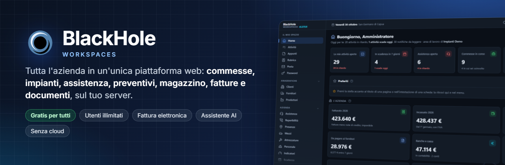

  
  
  
  
  

  <a href="https://github.com/brn78/BlackHole-Workspaces/releases/latest"><b>⬇️ Scarica il setup</b></a>
  &nbsp;·&nbsp;
  <a href="docs/guida/README.md"><b>📖 Guida utente</b></a>
  &nbsp;·&nbsp;
  <a href="#-gratis-per-tutti"><b>🆓 Licenza</b></a>
  &nbsp;·&nbsp;
  <a href="#-domande-frequenti"><b>❓ Domande frequenti</b></a>

---

**BlackHole Workspaces** è la piattaforma web per gestire tutta l'azienda in un unico posto: clienti e fornitori,
commesse e impianti, assistenza e manutenzioni, preventivi, magazzino e acquisti, fatture elettroniche e contabilità,
personale, mezzi, scadenze e documenti. È nata per le aziende di impianti (elettrici, sicurezza, fotovoltaico, reti,
domotica) e va bene per qualunque azienda di servizi tecnici.

Si installa su un PC o un server Windows dell'ufficio, gira come servizio e si usa da qualsiasi browser, dal PC, dal
tablet o dal telefono, con account personali e permessi. **È gratis per tutti**, senza limiti di utenti, commesse o
documenti e senza abbonamenti: i dati restano sul tuo server.

  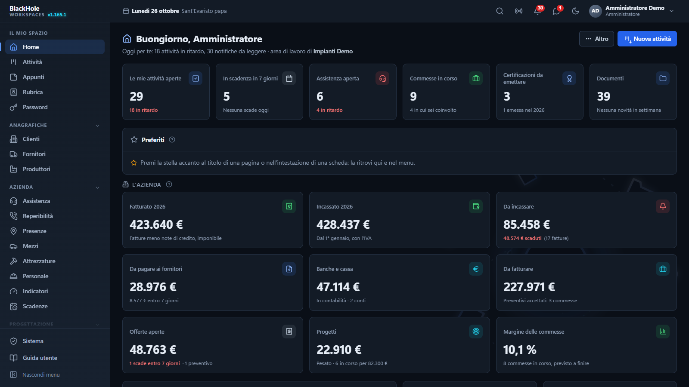

## ✨ Funzionalità

<table>
<tr>
<td width="50%" valign="top">

**🗓️ La mia giornata** 
Home con i numeri che contano, attività con kanban, calendario e Gantt, appunti ed elenchi condivisi, gestione delle
password cifrata con le cartelle aziendali e i codici della verifica in due passaggi, **rubrica** personale o condivisa
importata dal telefono (vCard, CSV di Google), con le foto, che diventa cliente in un clic.

**🏢 Clienti e fornitori** 
Un'anagrafica sola con ruoli, contatti privati o condivisi, gruppi e categorie, **importazione ed esportazione
universali** (Excel con tutti i suoi fogli, CSV, vCard, METEL, il modello da compilare, il vecchio gestionale),
l'**avviso dei possibili doppioni** mentre si scrive (in tutte le anagrafiche, dagli articoli alle
password), e la **valutazione del cliente**: come paga, quanto è fedele, quanto lavoro porta e quanto si guadagna.

**🛠️ Commesse e impianti** 
Progetti con attività, budget e consuntivo; impianti dei clienti con la loro cartella e il Leggimi; certificazioni
(conformità e rispondenza) numerate e pronte da firmare; manutenzioni periodiche con rapporti e firme sullo schermo;
pratiche con gli enti (GSE, Terna, ENEA, Comune, wallbox).

**🎧 Assistenza** 
Richieste dei clienti con priorità e scadenze, interventi pianificati, laboratorio con cartellino e ricevuta,
consuntivo e fatturazione, reperibilità con turni, cambi e avvisi fuori orario.

**💶 Commerciale e amministrazione** 
Listino con ricarichi e storico dei prezzi, listini dei fornitori **METEL**, trattative, **preventivi** con firma online
del cliente, magazzino con furgoni e matricole, ordini e richieste d'offerta, DDT e **fatture elettroniche** (FatturaPA)
inviate allo SDI con la PEC, fatture dei fornitori, incassi e solleciti, banca, **contabilità** in partita doppia fino al
bilancio CEE.

</td>
<td width="50%" valign="top">

**👷 Azienda** 
Personale con corsi, visite e documenti in scadenza, **indicatori** dell'azienda, dei reparti e delle persone con
obiettivi, valutazioni e premi di fine anno (facoltativi, con i nomi che si vogliono), mezzi e attrezzature con
revisioni e tagliandi, un unico **scadenzario** con i promemoria (anche come calendario per Outlook, Google e il telefono), **privacy** (GDPR): informative, registro dei
trattamenti, richieste e violazioni.

**📁 Documenti** 
Cartelle e file con revisioni, ricerca anche dentro i testi, visualizzatore per PDF, Word, Excel, immagini e disegni
**DWG, DXF e DWF** con misure e annotazioni, link di condivisione con password e scadenza, archivio di rete in sola
lettura.

**🤖 Assistente AI** 
Locale sul server oppure in cloud (Claude, OpenAI, Gemini): migliora i testi, compila le schede da un testo o da un PDF,
legge i documenti con l'OCR, risponde con la guida.

**🧰 Strumenti** 
Monitoraggio di dispositivi e siti con la topologia, perdita e jitter, scanner della rete locale con IPv6, porte e
servizi, **strumenti di rete** (ping, traceroute, DNS, WHOIS, porte, traffico, prove della connessione), **voce da testo** per centralini,
annunci e video, chat interna e notifiche anche su **Telegram**.

**⚙️ Pensato per il server** 
Servizio di Windows con icona di stato, backup automatici cifrati, aggiornamento dalla piattaforma con l'avviso delle
nuove versioni e l'avviso a chi è collegato, **sezioni del menu** da spegnere se l'azienda non le usa, verifica in due
passaggi, registro attività, tema chiaro e scuro, app installabile sul telefono.

</td>
</tr>
</table>

## 🖼️ Uno sguardo alla piattaforma

<table>
<tr>
<td width="50%" align="center">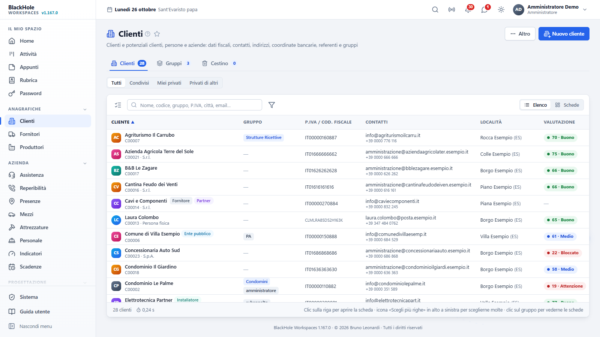 <b>Clienti</b>: ruoli, gruppi, contatti e giudizio</td>
<td width="50%" align="center">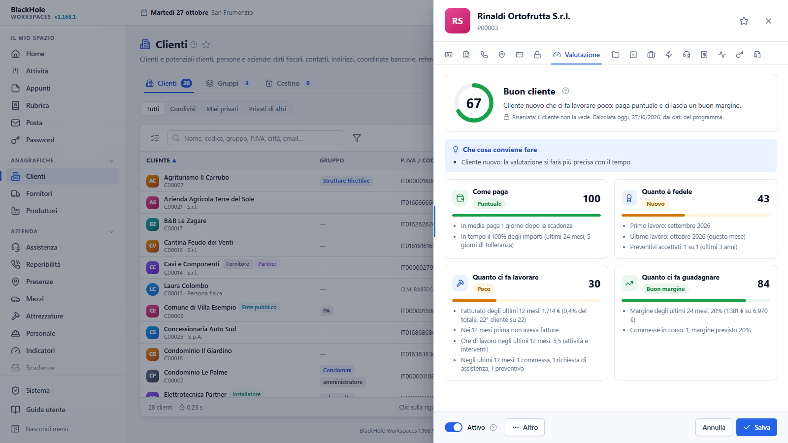 <b>Valutazione del cliente</b>: come paga, quanto lavora e rende</td>
</tr>
<tr>
<td align="center">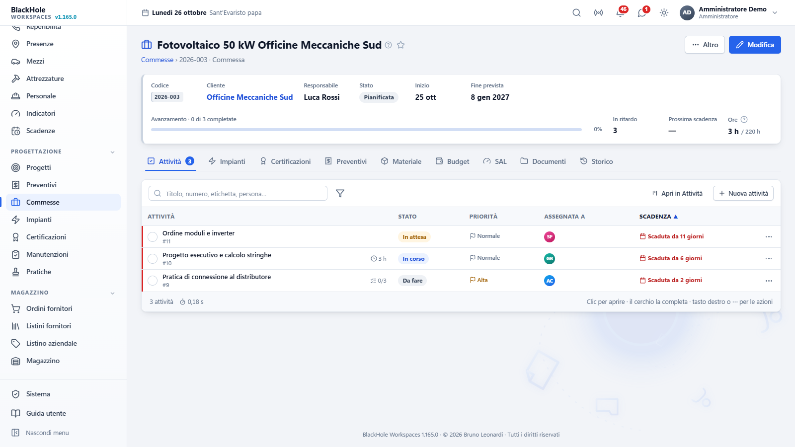 <b>Commesse</b>: attività, impianti, preventivi, budget, documenti</td>
<td align="center">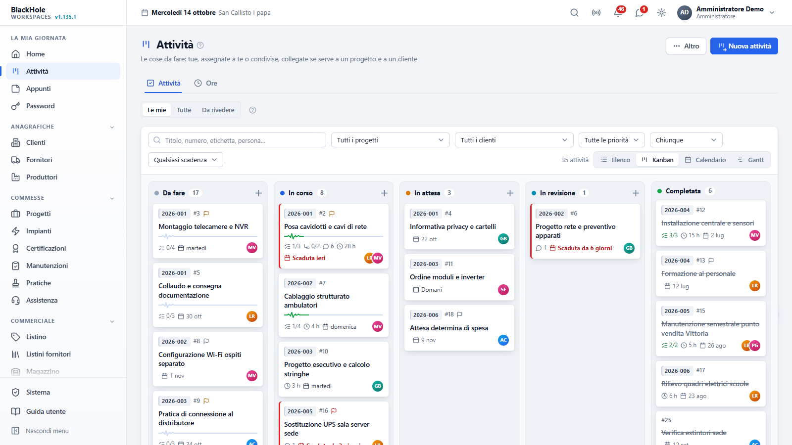 <b>Attività</b>: kanban, calendario e Gantt</td>
</tr>
<tr>
<td align="center">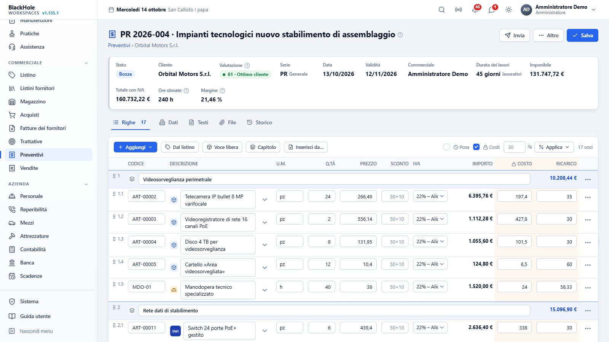 <b>Preventivi</b>: capitoli, listino, margini e firma online</td>
<td align="center">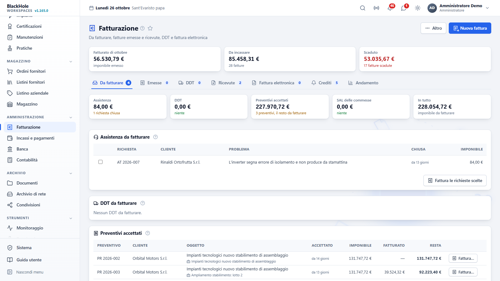 <b>Vendite</b>: DDT, fatture elettroniche e incassi</td>
</tr>
<tr>
<td align="center">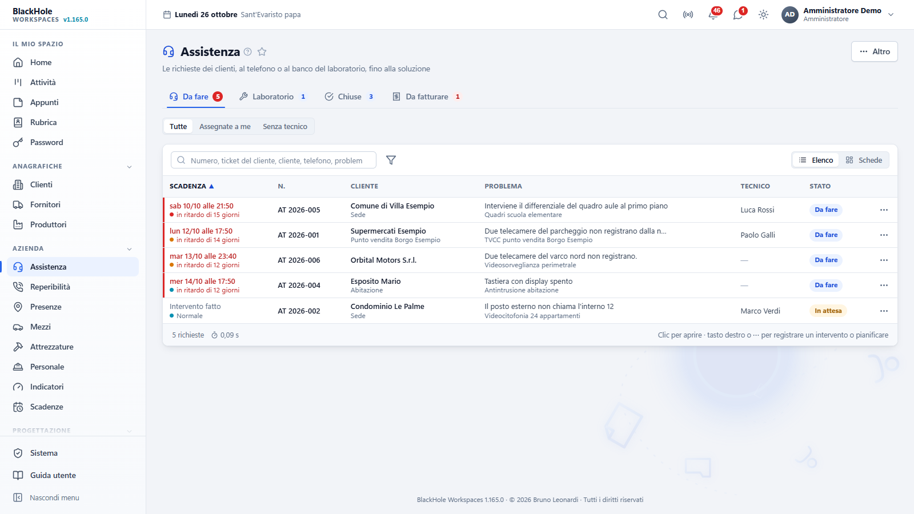 <b>Assistenza</b>: richieste, interventi e laboratorio</td>
<td align="center">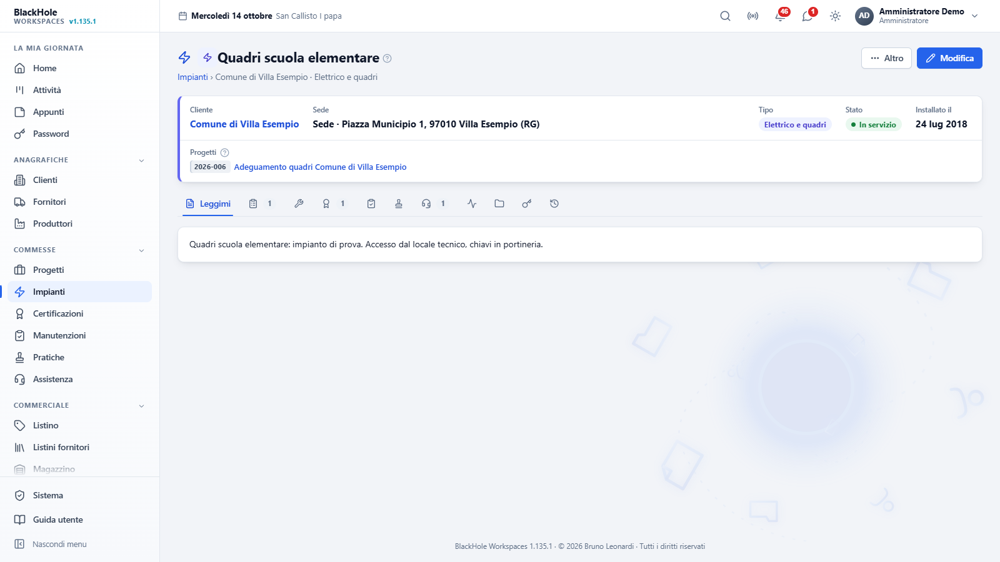 <b>Impianti</b>: il Leggimi, i file e la storia di ogni impianto</td>
</tr>
<tr>
<td align="center">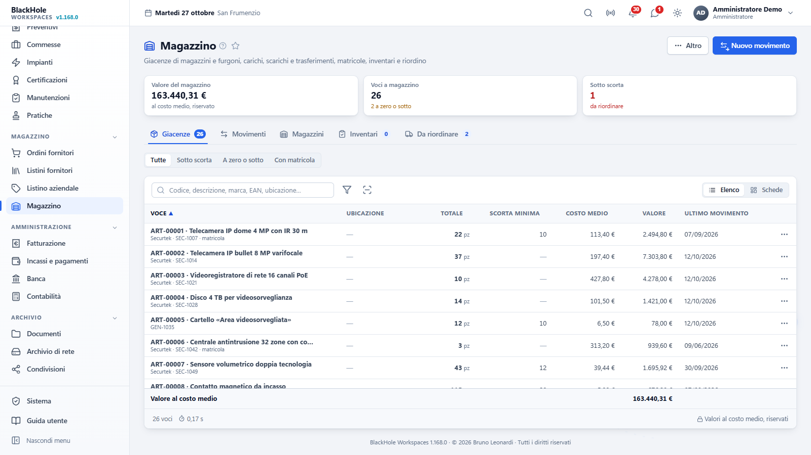 <b>Magazzino</b>: sede e furgoni, costo medio, inventari</td>
<td align="center">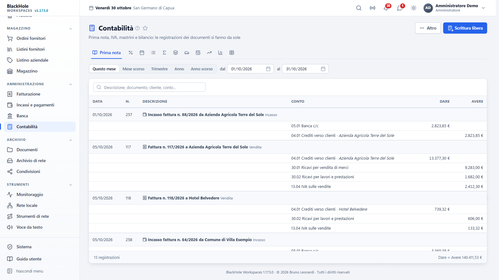 <b>Contabilità</b>: prima nota automatica, IVA e bilancio</td>
</tr>
<tr>
<td align="center">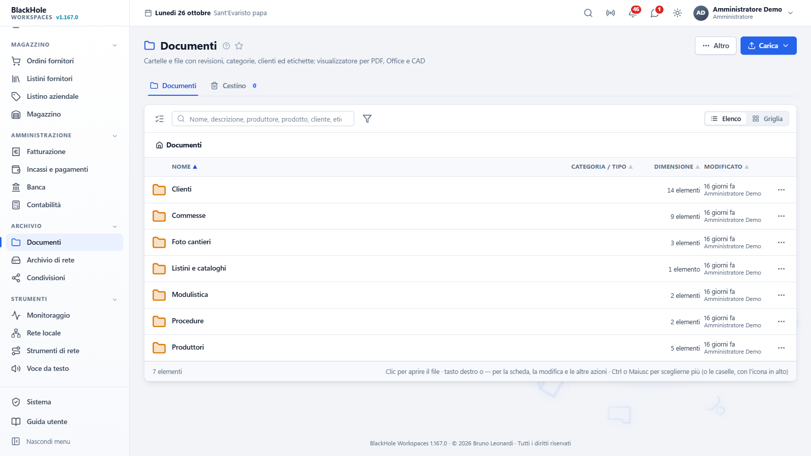 <b>Documenti</b>: cartelle, revisioni e visualizzatore</td>
<td align="center">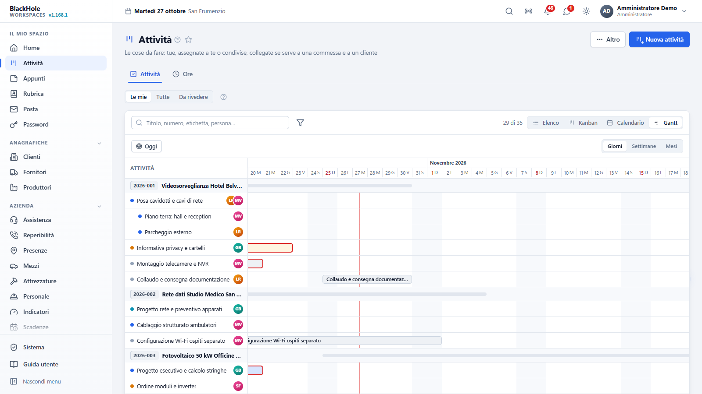 <b>Gantt</b> delle attività per commessa</td>
</tr>
<tr>
<td align="center">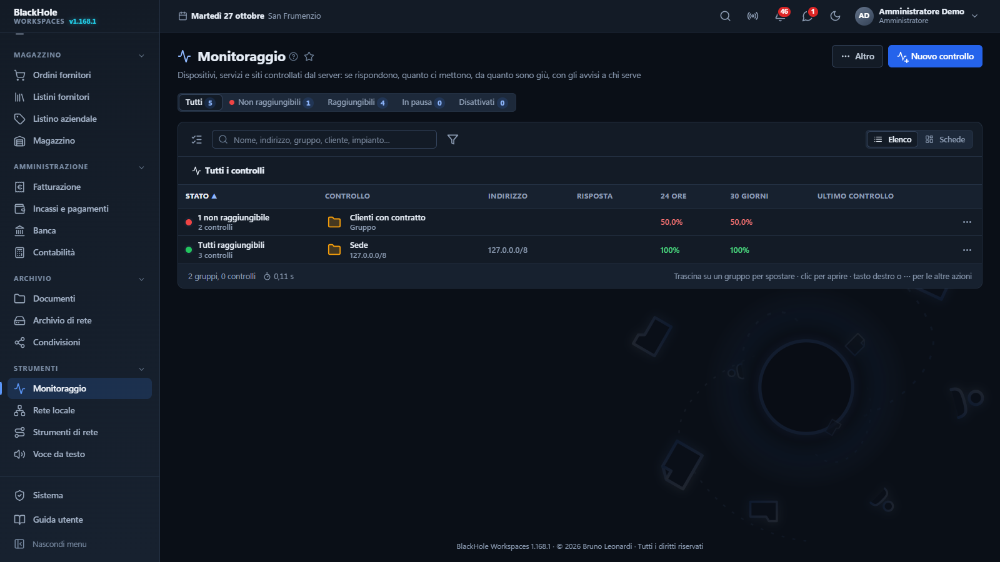 <b>Monitoraggio</b> di dispositivi, servizi e siti</td>
<td align="center">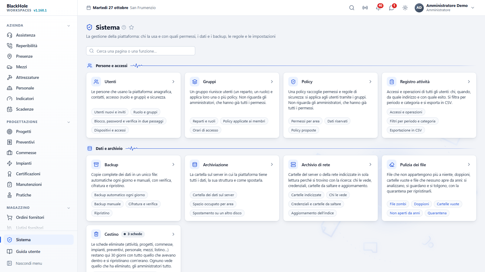 <b>Sistema</b>: utenti, permessi, backup e impostazioni</td>
</tr>
<tr>
<td align="center">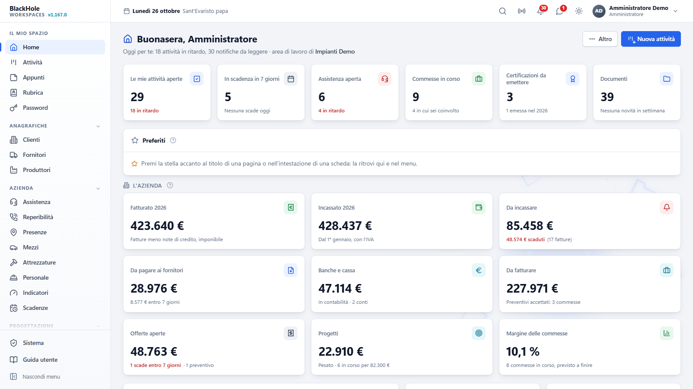 <b>Tema chiaro o scuro</b>, anche automatico</td>
<td align="center">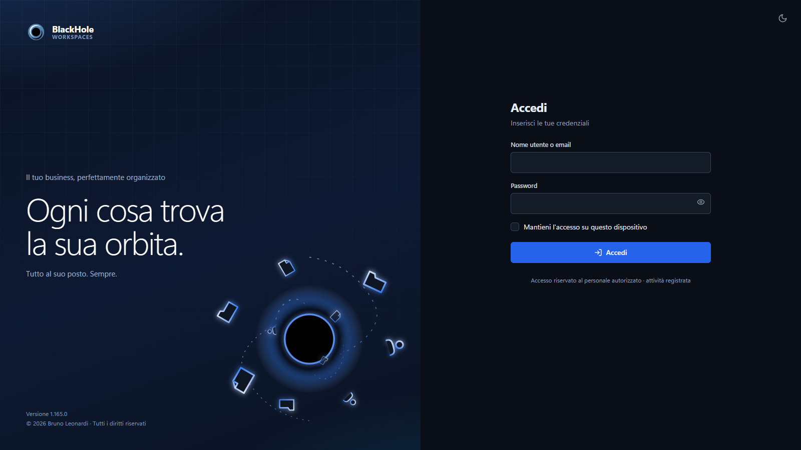 <b>Accesso protetto</b>, con verifica in due passaggi</td>
</tr>
<tr>
<td align="center">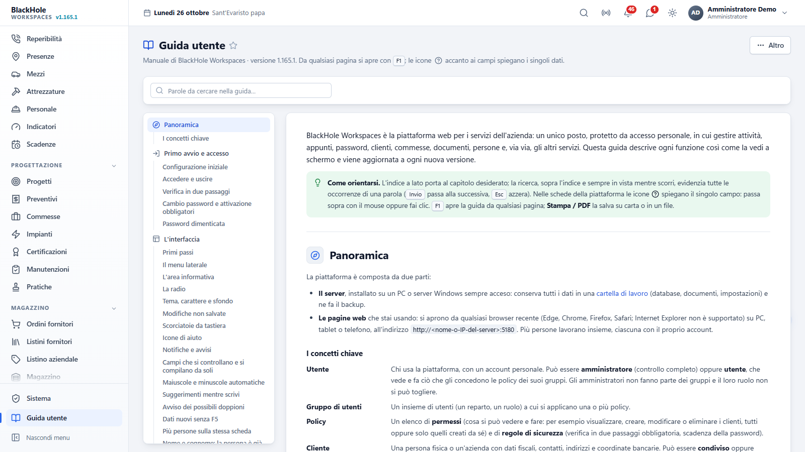 <b>Guida integrata</b>: <kbd>F1</kbd> da qualsiasi pagina</td>
<td align="center">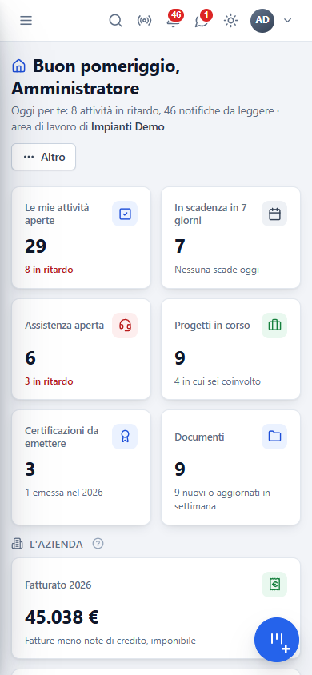 <b>Anche dal telefono</b>, come un'app</td>
</tr>
</table>

## 🆓 Gratis per tutti

BlackHole Workspaces si usa **gratis**, da privati, professionisti, aziende ed enti, **anche per uso commerciale**:

- **nessun limite** di utenti, installazioni, commesse o documenti;
- **nessuna scadenza**, nessuna registrazione e nessuna chiave di attivazione;
- il setup si può distribuire liberamente, gratis e senza modifiche; il tuo lavoro di installazione e assistenza lo
  puoi far pagare.

È gratuito il programma, cioè l'eseguibile: il codice sorgente non è pubblico e il programma non si può vendere né
modificare. Il programma è fornito **così com'è**, senza garanzie: importi, fatture elettroniche, contabilità e scadenze
vanno controllati prima di usarli, e i backup sono responsabilità di chi lo installa. Le condizioni complete sono nella
**[licenza d'uso e responsabilità](LICENZA.md)**, che il setup chiede di accettare; i componenti di terze parti sono
elencati in [THIRD-PARTY-NOTICES.md](THIRD-PARTY-NOTICES.md).

## ⬇️ Download

Scarica **`BlackHoleWorkspaces-<versione>-Setup.exe`** dalla pagina
[Releases](https://github.com/brn78/BlackHole-Workspaces/releases/latest). Il setup contiene tutto il necessario, compreso
il runtime .NET: non serve installare altro. Nella stessa pagina ci sono i [dati dimostrativi](#-provala-con-i-dati-dimostrativi)
per provarla. Le novità di ogni versione sono nel [registro delle versioni](CHANGELOG.md).

## 💻 Requisiti

- **Server**: Windows 10 (1607 o successivo) o 11, oppure Windows Server 2016, 2019, 2022 o 2025 (anche Server Core), a
  64 bit, sempre acceso e in rete con le postazioni. Va bene anche un normale PC dell'ufficio; l'assistente AI locale
  vuole più memoria (in alternativa si usa quello in cloud).
- **Postazioni**: un browser recente (Edge, Chrome, Firefox, Safari) su PC, tablet o telefono.
- **Internet**: non serve. Serve solo per i servizi che scegli di collegare (PEC e SDI, assistente AI in cloud,
  Telegram, accesso da fuori).

## 🚀 Installazione in quattro passi

1. **Esegui il setup sul server** come amministratore: accetta la licenza, scegli la cartella dei dati (meglio un disco
   dati), la porta (predefinita 5180) e, se vuoi, crea subito l'account amministratore. Il setup installa il servizio
   di Windows, apre la porta nel firewall e controlla che la piattaforma risponda.
2. **Apri la piattaforma** da qualsiasi PC della rete: `http://<nome-o-IP-del-server>:5180`. Se nel setup non hai creato
   l'amministratore, crealo dal browser sul PC del server (`http://localhost:5180`).
3. **Crea gli utenti** da *Sistema → Utenti* e dai i permessi con gruppi e policy (ci sono policy già pronte per i ruoli
   più comuni).
4. **Porta i dati**: clienti, personale, mezzi, listini e password si importano da Excel, CSV o PDF; i *Primi passi* di
   ogni pagina guidano il resto.

Tutti i dettagli sono nella [guida utente](docs/guida/server.md).

## 🧪 Provala con i dati dimostrativi

Per valutare la piattaforma senza inserire nulla, ogni release porta anche
**`BlackHoleWorkspaces-demo-<versione>.bhbak`**: un backup con un'azienda inventata («Impianti Demo S.r.l.») e tutti i
moduli pieni, da gennaio a ottobre: clienti e fornitori, rubrica, preventivi, commesse, impianti, assistenza,
magazzino, acquisti, vendite con la fatturazione elettronica, banca, contabilità, personale, mezzi, indicatori e premi,
password, documenti e rete locale. Nomi, numeri e indirizzi sono tutti di fantasia.

1. Installa la piattaforma su un **PC di prova** e crea l'amministratore.
2. In *Sistema → Backup* scegli **Carica backup** e poi **Ripristina** sulla sua riga: la password del backup è
   `demo-backup`.
3. Dopo il riavvio entra con `admin` / `admin` (gli altri utenti della demo hanno la password `demo1234`).

> [!WARNING]
> Il ripristino sostituisce tutti i dati del server: non farlo mai su quello che usi davvero. Istruzioni e contenuto
> sono in `BlackHoleWorkspaces-demo-LEGGIMI.txt`, allegato alla stessa release.

## 🔄 Aggiornamenti

Quando esce una nuova versione la piattaforma lo dice: una volta al giorno il server chiede a GitHub qual è l'ultima
versione pubblicata e, se è più recente, gli amministratori ricevono una notifica con le novità.

In *Sistema → Impostazioni → Aggiornamento del programma* basta **Scarica e installa**: il server scarica il setup da
questa pagina, controlla che sia proprio quello pubblicato (impronta SHA-256), fa il backup completo dei dati e lo
installa; dopo circa un minuto la piattaforma si ricarica con la nuova versione. Prima di confermare si vede chi è
collegato, lo si può avvisare o invitare a non operare; durante l'aggiornamento nessuno entra e la pagina di accesso si
riapre da sola appena il server è di nuovo online. In alternativa il setup si scarica a
mano e si carica nello stesso riquadro, oppure si esegue sul server. Dati, account e impostazioni restano. Nulla si
installa senza che un amministratore lo chieda e non viene inviato alcun dato dell'azienda; l'avviso si può spegnere.

## 📖 Guida utente

La **[guida utente completa](docs/guida/README.md)** descrive ogni pagina, dall'installazione alla risoluzione dei
problemi. È la stessa che si apre nella piattaforma con <kbd>F1</kbd>, con l'indice, la ricerca, la stampa in PDF e la
modalità *Chiedi alla guida* con l'assistente AI.

## 🔒 Sicurezza e dati

- Accesso con password e **verifica in due passaggi**, browser di fiducia, blocco dei tentativi errati, sessioni che
  scadono, orari di accesso per gruppo, **avviso di accesso** per email o Telegram (a ogni accesso o da un browser
  nuovo).
- **Regole delle password** scelte dall'amministratore (lunghezza e complessità) e controllo delle **password
  trafugate** con Have I Been Pwned, senza che la password esca dal server: per gli utenti, la gestione password e le
  password dei servizi.
- **Permessi** per area con gruppi e policy, contatti privati, dati riservati (costi, coordinate bancarie) solo a chi
  può vederli.
- **Registro attività** di accessi e operazioni, esportabile.
- **Backup** automatici ogni giorno, cifrati e verificati, con ripristino, anche su un NAS (con il suo utente, scelto
  con «Sfoglia»); cestino di 30 giorni per le schede eliminate.
- Password dei servizi e della gestione password **cifrate** sul server; nessun servizio cloud obbligatorio: i dati
  restano in azienda.

## ❓ Domande frequenti

<b>È davvero gratis? Dove sta il trucco?</b>

 
È gratis e basta: niente limiti, niente scadenze, niente versione «pro» a pagamento e nessun dato raccolto. Il
programma è dato in uso così com'è, senza garanzie e senza assistenza obbligatoria: per questo la licenza chiede di
controllare i risultati e di fare i backup.

<b>Quanti utenti e quante commesse regge?</b>

 
Non ci sono limiti nel programma. Un'azienda con una ventina di persone in ufficio, qualche tecnico in campo e decine di
commesse in corso lavora su un normale PC da ufficio usato come server.

<b>Serve una connessione a Internet?</b>

 
No. Server e postazioni lavorano nella rete locale. Internet serve solo per i servizi che colleghi tu: invio delle
fatture allo SDI con la PEC, assistente AI in cloud, notifiche Telegram, accesso da fuori tramite un proxy HTTPS o una
VPN, e per l'avviso delle nuove versioni.

<b>Le fatture elettroniche vanno davvero allo SDI?</b>

 
Sì: la piattaforma crea il file FatturaPA, lo controlla con lo schema ufficiale e lo invia allo SDI con la tua PEC,
poi legge le ricevute e segnala gli scarti da correggere. Le fatture dei fornitori si caricano da XML, .p7m o ZIP,
oppure arrivano dalla PEC. Controlla sempre i documenti prima di inviarli.

<b>Posso usarlo dal telefono?</b>

 
Sì, da qualsiasi browser; sul telefono la piattaforma si installa come un'app (PWA) e alcune pagine restano
consultabili anche senza rete.

<b>Come si aggiorna e cosa succede ai dati?</b>

 
Da <b>Sistema → Impostazioni → Aggiornamento del programma</b> premi <b>Scarica e installa</b> e confermi con la tua
password: il server scarica e controlla il setup, fa il backup e lo installa; il servizio si ferma per circa un minuto
e la piattaforma si ricarica da sola. Dati, account e impostazioni restano; il database viene copiato prima di ogni
aggiornamento.

<b>Posso avere il codice sorgente o una versione personalizzata?</b>

 
No: è gratuito l'eseguibile, il codice sorgente non è pubblico. Suggerimenti e segnalazioni sono benvenuti nella
pagina <a href="https://github.com/brn78/BlackHole-Workspaces/issues">Issues</a>.

## 📬 Contatti

Segnalazioni e suggerimenti: pagina [Issues](https://github.com/brn78/BlackHole-Workspaces/issues) oppure
**b.leonardi78@gmail.com**.

---

  © 2026 Bruno Leonardi · Tutti i diritti riservati · Gratis per tutti secondo la <a href="LICENZA.md">licenza d'uso</a>. 
  I marchi citati appartengono ai rispettivi proprietari. Le immagini mostrano dati dimostrativi.

